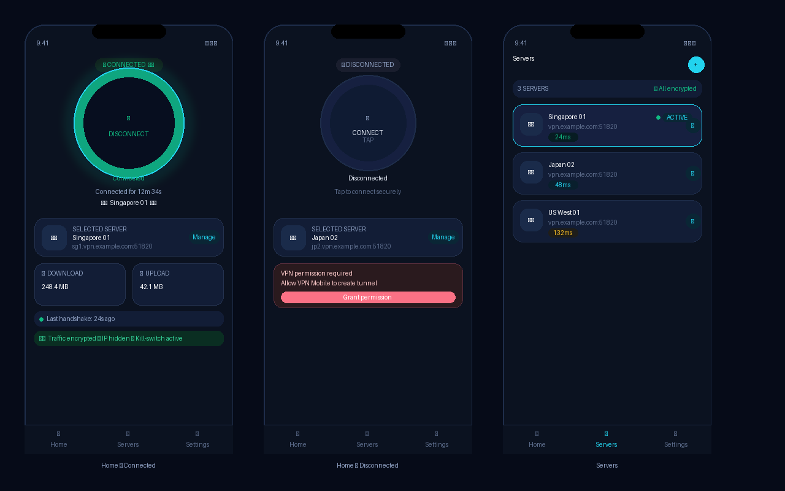

# VortexHub — Premium Android VPN

<p align="center">
  
</p>

<p align="center">
  <strong>🔒 Secure • 🚀 Fast • 🎨 Beautiful</strong>
</p>

---

## 🎨 UI Preview


---

## ✨ Features

### 🔐 Security
- **AES-256 Encryption** — Keystore-encrypted configs
- **Kill Switch** — Block internet when VPN drops
- **Anti-Root Detection** — Security hardening
- **SSL Pinning** — Certificate transparency
- **Debug Log Strip** — No sensitive data in logs

### 🌐 Protocols
- **Shadowsocks** — Xray Core
- **VLESS** — Xray Core with Reality
- **VMess** — Xray Core
- **Trojan** — Xray Core
- **WireGuard** — GoBackend (userspace)

### ⚡ Performance
- **Xray Core** — Real process management
- **WARP Integration** — Cloudflare network
- **Split Tunneling** — Exclude/Include apps
- **Auto-Reconnect** — Retry on failure
- **Latency Display** — Real-time ping

### 🎨 UI/UX
- **Dark Theme** — #0A0A0A background
- **Orange Accent** — #FF8C00 brand color
- **Glass Buttons** — Frosted glass effect
- **3D Tilt Cards** — Interactive animations
- **Particles** — Connected state animation
- **Splash Screen** — V logo with pulse & fade-in scale
- **Navigation Transitions** — Fade/slide between screens
- **Bottom Bar Motion** — Animated pill selection scaling

### 📱 Management
- **Server Favorites** — Star toggle
- **Connection History** — Last 10 connections
- **Custom DNS** — Cloudflare/Google
- **Free Server Update** — GitHub/Cloudflare URL
- **QR Code Import** — CameraX + MLKit

---

## 🛠️ Tech Stack

| Component | Technology |
|---|---|
| Language | Kotlin 2.1 |
| UI | Jetpack Compose (Material 3) |
| VPN Engine | WireGuard GoBackend + Xray Core |
| Camera | CameraX + MLKit Barcode |
| Billing | Google Play Billing 7.0 |
| Persistence | DataStore Preferences |
| Navigation | Navigation Compose |
| Security | AndroidKeyStore AES |
| Min SDK | 24 (Android 7.0) |
| Target SDK | 35 (Android 15) |

---

## 📂 Project Structure

```
app/src/main/java/com/vpnmobile/app/
├── MainActivity.kt              # Entry point
├── VpnApplication.kt            # Application setup
├── data/
│   ├── ConfigTools.kt           # Protocol parsing
│   ├── Crypto.kt                # AES encryption
│   ├── PingTester.kt            # TCP latency
│   ├── PremiumManager.kt        # Billing
│   ├── ServerApi.kt             # Free server fetch
│   ├── TunnelProfile.kt         # Server model
│   ├── TunnelStore.kt           # DataStore prefs
│   ├── WarpGenerator.kt         # WARP key gen
│   └── WarpScanner.kt           # CF range scan
├── vpn/
│   ├── VpnConnectionManager.kt  # VPN lifecycle
│   ├── VpnNotification.kt       # Notifications
│   ├── SecurityCheck.kt         # Root/debug detect
│   ├── XrayConfigGenerator.kt   # URI → JSON
│   ├── XrayManager.kt           # Xray process
│   └── XrayDownloader.kt        # GitHub download
└── ui/
    ├── MainViewModel.kt         # State management
    ├── VpnApp.kt                # Navigation
    ├── PowerIcon.kt             # Custom icon
    ├── effects/
    │   ├── Card3D.kt            # Tilt animation
    │   └── GlassButton.kt       # Glass effect
    └── screens/
        ├── SplashScreen.kt      # V logo intro
        ├── HomeScreen.kt        # Power button
        ├── ServersScreen.kt     # Server list
        ├── SettingsScreen.kt    # VPN settings
        ├── PersonScreen.kt      # Profile/keys
        ├── ImportScreen.kt      # URI input
        ├── QrScanScreen.kt      # Camera scan
        ├── PremiumScreen.kt     # Billing
        ├── SplitTunnelScreen.kt # App selection
        └── WarpGenerateScreen.kt# WARP setup
```

---

## 🚀 Build & Install

### GitHub Actions (Automatic)
1. Push to `master` branch
2. Go to **Actions** tab
3. Download `VortexHub.apk` artifact

### Local Build
```bash
# Set Android SDK path
export ANDROID_HOME=/path/to/Android/Sdk

# Build debug APK
./gradlew :app:assembleDebug

# Install (device connected)
adb install app/build/outputs/apk/debug/app-debug.apk
```

### Requirements
- JDK 17+
- Android SDK 35
- Android Studio Ladybug+ (or CLI)

---

## 📱 Screenshots

### 🏠 Home Screen
- Power button with orange gradient
- Connection status (Connected/Disconnected)
- Real-time latency display
- Download/Upload stats
- Session timer
- Kill switch indicator

### ⚙️ Configs Screen
- Free/Favorites/Personal tabs
- Server list with flags
- Ping latency per server
- Star toggle for favorites
- Add server button
- QR scan button

### ⚙️ Settings Screen
- Auto-Connect toggle
- Auto-Reconnect toggle
- Kill Switch toggle
- Split Tunneling toggle
- DNS selector (Cloudflare/Google)
- About/Version info

### 👤 Person Screen
- Device Hardware ID
- Free Server URL input
- Premium upgrade card
- Settings shortcut
- Saved configs list
- Copy/Delete actions

---

## 🔧 Configuration

### Free Server Update
1. Edit `server.json` on GitHub
2. Push to master
3. App auto-fetches on refresh
4. No APK rebuild needed

### WARP Setup
1. Go to Configs → WARP
2. Generate key pair
3. Register with Cloudflare
4. Auto-configures WireGuard

### Split Tunneling
1. Go to Settings → Split Tunnel
2. Select apps to exclude/include
3. Connect VPN
4. Selected apps bypass VPN

---

## 🛡️ Security Features

- **AES-256 Keystore** — Configs encrypted at rest
- **Anti-Root** — Detects rooted devices
- **Anti-Debug** — Blocks debugger attachment
- **SSL Pinning** — Certificate validation
- **No Logs** — Privacy-first design
- **Kill Switch** — No IP leaks

---

## 📋 License

MIT License — Free to use and modify

---

## 🤝 Contributing

1. Fork the repository
2. Create feature branch
3. Commit changes
4. Push to branch
5. Create Pull Request

---

## 📞 Support

- **GitHub Issues:** [Report bugs](https://github.com/MrStealer111/VortexHub/issues)
- **Email:** support@vortexhub.app

---

<p align="center">
  <strong>VortexHub VPN</strong><br>
  <sub>Made with ❤️ for privacy</sub>
</p>
