# VortexHub — Premium Android VPN

<p align="center">
  <strong>🔒 Secure • 🚀 Fast • 🎨 Beautiful</strong>
</p>

---

## 🎨 UI Preview

<p align="center">
  
</p>
<p align="center"><sub>Home — Connected &nbsp;·&nbsp; Home — Disconnected &nbsp;·&nbsp; Configs · Personal</sub></p>

<details>
<summary><strong>📸 Full UI gallery — 12 screens</strong></summary>
<br>

| | | |
|:--:|:--:|:--:|
| <a href="docs/previews/02_home_connected.png">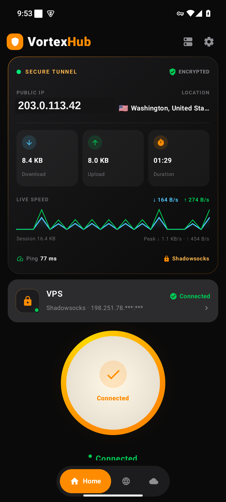</a><br><sub>Home · Connected</sub> | <a href="docs/previews/01_home_disconnected.png">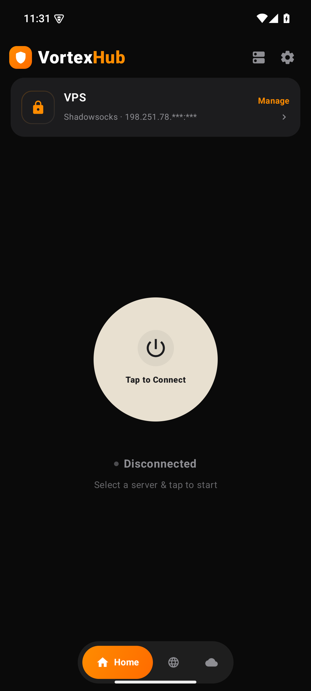</a><br><sub>Home · Disconnected</sub> | <a href="docs/previews/03_configs_personal.png">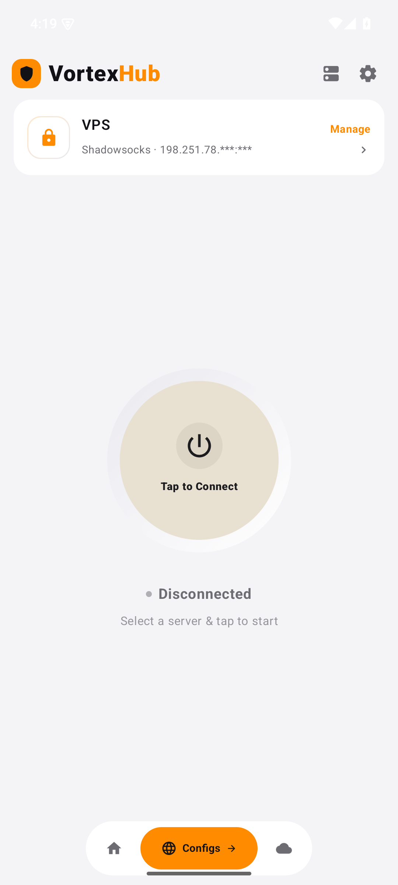</a><br><sub>Configs · Personal</sub> |
| <a href="docs/previews/04_subscriptions.png">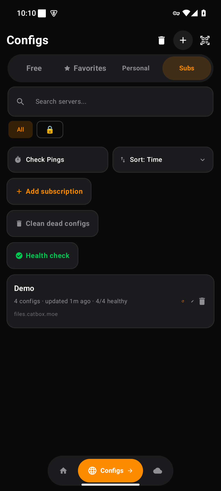</a><br><sub>Subscriptions</sub> | <a href="docs/previews/05_person.png">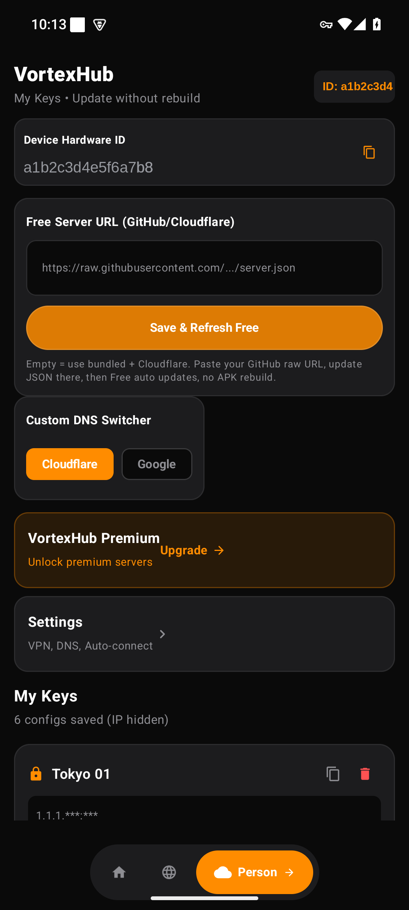</a><br><sub>Person · Free Servers</sub> | <a href="docs/previews/06_settings_top.png">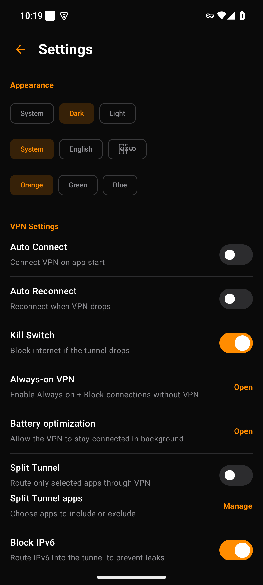</a><br><sub>Settings · VPN</sub> |
| <a href="docs/previews/07_settings_bottom.png">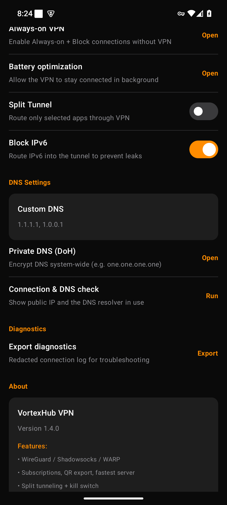</a><br><sub>Settings · DNS &amp; About</sub> | <a href="docs/previews/08_dns_check.png">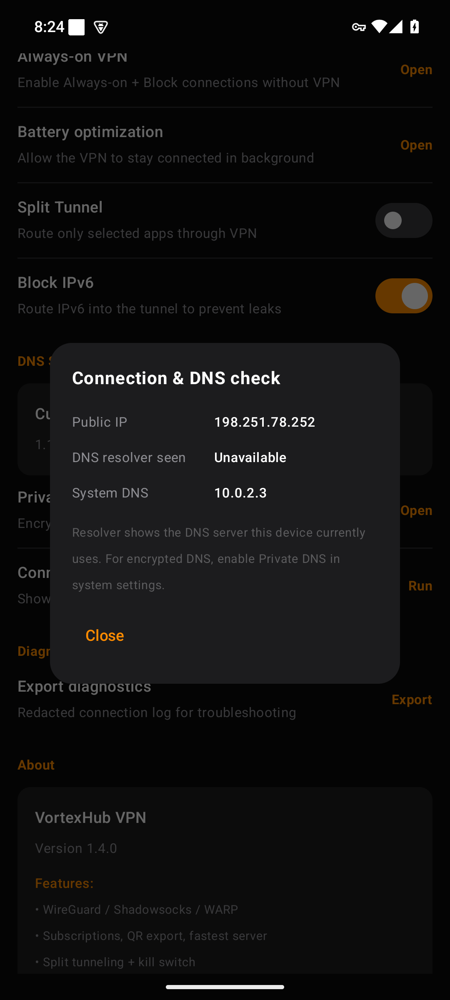</a><br><sub>DNS / IP Check</sub> | <a href="docs/previews/09_qr_share.png">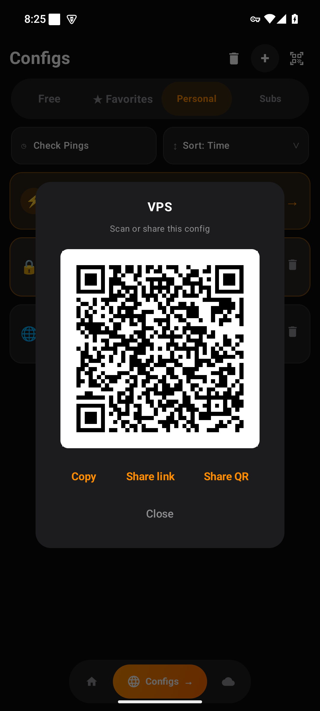</a><br><sub>QR Export</sub> |
| <a href="docs/previews/10_qs_tile.png">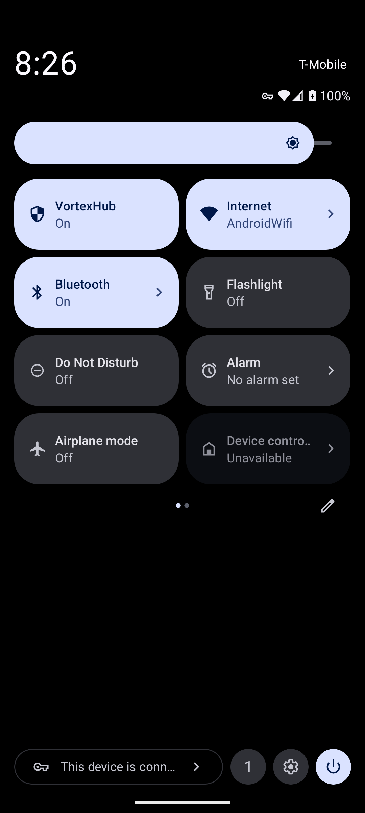</a><br><sub>Quick Settings Tile</sub> | <a href="docs/previews/11_widget.png">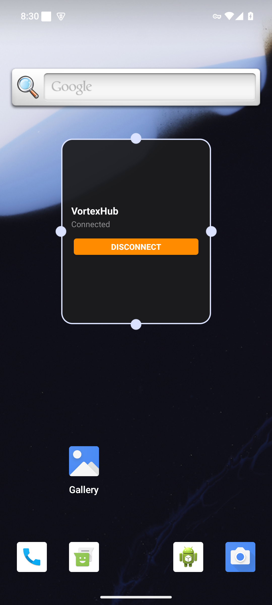</a><br><sub>Home Screen Widget</sub> | <a href="docs/previews/12_split_tunnel.png">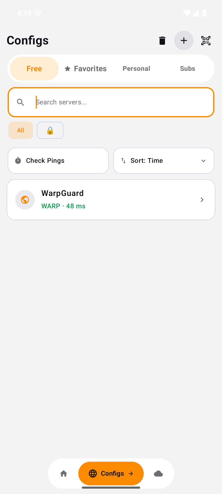</a><br><sub>Split Tunnel</sub> |

<p align="center"><sub>Screenshots from the real v1.4.0 build on Android 15 (API 35). QR code shown is a demo key, not a live server.</sub></p>
</details>

---

## ✨ Features

### 🔐 Security
- **AES-256 Encryption** — Keystore-encrypted configs
- **Kill Switch** — Fail-closed TUN; blocks internet if the tunnel or upstream drops
- **IPv6 Leak Protection** — Routes IPv6 into the tunnel (optional block mode)
- **Anti-Root Detection** — Security hardening

### 🌐 Protocols
- **WireGuard** — GoBackend (userspace) ✅
- **Cloudflare WARP** — auto key generation ✅
- **Shadowsocks** — Outline / SIP002 links ✅
- **VLESS / VMess / Trojan** — not supported

### ⚡ Performance
- **WARP Integration** — Cloudflare network
- **Real tunnel stats** — live handshake, RX/TX
- **Split Tunneling** — Exclude/Include apps
- **Auto-Reconnect** — Retry on failure
- **Latency Display** — Real-time ping

### 🎨 UI/UX
- **Dark Theme** — #0A0A0A background
- **Orange Accent** — #FF8C00 brand color
- **Glass Buttons** — Frosted glass effect
- **3D Tilt Cards** — Interactive animations
- **Particles** — Connected state animation
- **Splash Screen** — V logo with pulse & fade-in scale
- **Navigation Transitions** — Fade/slide between screens
- **Bottom Bar Motion** — Animated pill selection scaling

### 📱 Management
- **Server Favorites** — Star toggle
- **Connection History** — Last 10 connections
- **Custom DNS** — Cloudflare/Google
- **Custom Server JSON** — asset list or your own URL
- **QR Code Import / Share** — CameraX + MLKit import, ZXing QR export
- **Subscriptions** — ss://, WireGuard and base64 lists with refresh
- **Fastest Server** — One-tap lowest-latency pick
- **Quick Settings Tile** — Connect/disconnect from the shade
- **Home Screen Widget** — Status + connect/disconnect button
- **Diagnostics** — Redacted log export and live DNS/IP check
- **Always-on VPN** — System always-on + block-without-VPN shortcut
- **Private DNS (DoH)** — System encrypted-DNS setup guide

---

## 🛠️ Tech Stack

| Component | Technology |
|---|---|
| Language | Kotlin 2.1 |
| UI | Jetpack Compose (Material 3) |
| VPN Engine | WireGuard GoBackend + Shadowsocks (tun2socks) + Cloudflare WARP |
| Camera | CameraX + MLKit Barcode |
| Billing | Google Play Billing 7.0 |
| Persistence | DataStore Preferences |
| Navigation | Navigation Compose |
| Security | AndroidKeyStore AES |
| Min SDK | 24 (Android 7.0) |
| Target SDK | 35 (Android 15) |

---

## 📂 Project Structure

```
app/src/main/java/com/vpnmobile/app/
├── MainActivity.kt              # Entry point
├── VpnApplication.kt            # Application setup
├── data/
│   ├── ConfigTools.kt           # Protocol parsing
│   ├── Crypto.kt                # AES encryption
│   ├── PingTester.kt            # TCP latency
│   ├── PremiumManager.kt        # Billing
│   ├── ServerApi.kt             # Free server fetch
│   ├── ShadowsocksConfig.kt     # ss:// parser
│   ├── TunnelProfile.kt         # Server model
│   ├── TunnelStore.kt           # DataStore prefs
│   ├── WarpGenerator.kt         # WARP key gen
│   └── WarpScanner.kt           # CF range scan
├── vpn/
│   ├── VpnConnectionManager.kt  # VPN lifecycle
│   ├── ShadowsocksVpnService.kt # Shadowsocks tunnel
│   ├── VpnNotification.kt       # Notifications
│   └── SecurityCheck.kt         # Root/debug detect
└── ui/
    ├── MainViewModel.kt         # State management
    ├── VpnApp.kt                # Navigation
    ├── PowerIcon.kt             # Custom icon
    ├── effects/
    │   ├── Card3D.kt            # Tilt animation
    │   └── GlassButton.kt       # Glass effect
    └── screens/
        ├── SplashScreen.kt      # V logo intro
        ├── HomeScreen.kt        # Power button
        ├── ServersScreen.kt     # Server list
        ├── SettingsScreen.kt    # VPN settings
        ├── PersonScreen.kt      # Profile/keys
        ├── ImportScreen.kt      # URI input
        ├── QrScanScreen.kt      # Camera scan
        ├── PremiumScreen.kt     # Billing
        ├── SplitTunnelScreen.kt # App selection
        └── WarpGenerateScreen.kt# WARP setup
app/src/androidTest/java/com/vpnmobile/app/
└── ShadowsocksTunnelTest.kt   # Emulator tunnel smoke test
```

---

## 📥 Download

Grab the latest debug APK from [Releases](https://github.com/MrStealer111/VortexHub/releases/latest).

## 🚀 Build & Install

### Local Build
```bash
# Set Android SDK path
export ANDROID_HOME=/path/to/Android/Sdk

# Build debug APK
./gradlew :app:assembleDebug

# Install (device connected)
adb install app/build/outputs/apk/debug/app-debug.apk
```

### Requirements
- JDK 17+
- Android SDK 35
- Android Studio Ladybug+ (or CLI)

---

## 📱 Screenshots

### 🏠 Home Screen
- Power button with orange gradient
- Connection status (Connected/Disconnected)
- Real-time latency display
- Download/Upload stats
- Session timer
- Kill switch indicator

### ⚙️ Configs Screen
- Free/Favorites/Personal tabs
- Server list with flags
- Ping latency per server
- Star toggle for favorites
- Add server button
- QR scan button

### ⚙️ Settings Screen
- Auto-Connect / Auto-Reconnect toggles
- Kill Switch + Always-on VPN
- Battery optimization shortcut
- Block IPv6 toggle
- Split Tunneling
- DNS selector, Private DNS (DoH) guide, DNS/IP check
- Diagnostics export (redacted)
- About/Version info

### 👤 Person Screen
- Device Hardware ID
- Free Server URL input
- Premium upgrade card
- Settings shortcut
- Saved configs list
- Copy/Delete actions

---

## 🔧 Configuration

### Free Server Update
1. Edit `app/src/main/assets/server.json`
2. Rebuild and install
3. Or set a custom server JSON URL in Profile → Free Server URL (fetched on refresh)

### Shadowsocks Engine
`app/libs/tun2socks.aar` is built from [outline-go-tun2socks](https://github.com/OutlineFoundation/outline-go-tun2socks) (Apache-2.0) with Go 1.24.5, gomobile `v0.0.0-20230906132913-2077a3224571`, and Android NDK 27.2. It bundles `libgojni.so` for `arm64-v8a` and `armeabi-v7a`. To regenerate:

```bash
gomobile bind -target=android -androidapi 24 \
  -ldflags="-extldflags=-Wl,-z,max-page-size=16384" \
  -o app/libs/tun2socks.aar \
  ./outline/tun2socks ./outline/shadowsocks
```

### WARP Setup
1. Go to Configs → WARP
2. Generate key pair
3. Register with Cloudflare
4. Auto-configures WireGuard

### Shadowsocks Setup
1. Create an access key in your Outline server or panel
2. Copy the `ss://...` link (or scan its QR code)
3. Go to Configs → + → Add manual config → Shadowsocks
4. Paste the link, save and connect

### Subscriptions
1. Go to Configs → + → Add subscription URL
2. Paste an HTTPS URL returning `ss://` links, WireGuard blocks, or a base64-encoded list
3. Open the Subs tab to refresh or delete the subscription

### Quick Settings & Widget
- Add the **VortexHub** tile from the Quick Settings edit screen
- Long-press the home screen → Widgets → VortexHub for the status widget

### Split Tunneling
1. Go to Settings → Split Tunnel
2. Select apps to exclude/include
3. Connect VPN
4. Selected apps bypass VPN

---

## 🙏 Third-party

- [WireGuard for Android](https://git.zx2c4.com/wireguard-android/) — tunnel backend
- [Outline tun2socks](https://github.com/OutlineFoundation/outline-go-tun2socks) — Shadowsocks engine (Apache-2.0)
- [go-tun2socks](https://github.com/eycorsican/go-tun2socks) — TUN stack

## 🛡️ Security Features

- **AES-256 Keystore** — Configs encrypted at rest
- **Anti-Root** — Detects rooted devices
- **Anti-Debug** — Blocks debugger attachment
- **SSL Pinning** — Certificate validation
- **No Logs** — Privacy-first design
- **Kill Switch** — Fail-closed, no IP leaks on tunnel or upstream loss
- **Redacted diagnostics** — Credentials stripped from exported logs

---

## 📋 License

MIT License — Free to use and modify

---

## 🤝 Contributing

1. Fork the repository
2. Create feature branch
3. Commit changes
4. Push to branch
5. Create Pull Request

---

## 📞 Support

- **GitHub Issues:** [Report bugs](https://github.com/MrStealer111/VortexHub/issues)
- **Email:** support@vortexhub.app

---

<p align="center">
  <strong>VortexHub VPN</strong><br>
  <sub>Made with ❤️ for privacy</sub>
</p>
